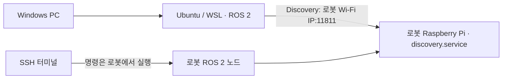

# TurtleBot 4 설정 및 트러블슈팅 기록

ROS 2 Humble 기반 TurtleBot 4를 설정하면서 겪은 **토픽이 두 개만 보이는 문제**, **Discovery Server 자동 시작 복구**, **사용자 PC의 WSL 연결 및 DNS 오류**를 정리한 한국어 작업 기록입니다.

기록 범위: 2026-10-13 ~ 2026-10-14 (한국 시간). 사용자 제공 터미널 화면과 공식 문서를 기반으로 작성했습니다. 이 저장소의 명령은 실행 위치를 확인한 뒤 필요한 단계만 사용하세요.

## 현재 상태

| 항목 | 확인 결과 |
|---|---|
| 로봇 SSH에서 토픽 조회 | 복구 확인 |
| 로봇 SSH에서 노드 조회 | 복구 확인 |
| Discovery Server 실행 상태 | `active` 확인 |
| Discovery Server 자동 시작 등록 | `enabled` 확인 |
| 재부팅 후 자동 복구 | 아직 확인하지 않음 |
| 각 센서의 실제 데이터 수신 | 아직 별도로 검증하지 않음 |
| Windows의 GitHub IPv4 DNS 조회 | 성공 확인 |
| WSL의 GitHub 스크립트 다운로드 | DNS 오류로 실패 |
| WSL 종료·재실행 후 다운로드 | 방법 안내까지 진행, 결과 미확인 |
| 사용자 PC에서 로봇 토픽 조회 | 아직 성공 확인 없음 |

**로봇 측 복구와 PC 측 연결 완료는 서로 다른 단계입니다.** 로봇 토픽은 복구했지만, WSL 네트워크 문제는 남아 있습니다.

## 문서 안내

1. [환경과 실행 위치](01-environment.md)
2. [로봇 토픽 두 개 문제와 Discovery Server 복구](02-robot-discovery-recovery.md)
3. [User PC Setup: WSL에서 로봇에 연결하기](03-user-pc-setup.md)
4. [WSL DNS 오류 진단과 다음 단계](04-wsl-dns.md)
5. [진행 기록과 남은 확인 항목](05-progress.md)

## 연결 구조

그림의 포트 11811은 Discovery Server 포트입니다. 센서 데이터 등 모든 ROS 2 통신이 이 포트 하나만 사용하는 것은 아닙니다. WSL에서 서버에 접근할 수 있어도 실제 DDS 데이터 통신은 추가 검증해야 합니다.

## 핵심 결론

- `/parameter_events`, `/rosout`만 보이면 로봇 연결이 정상이라는 뜻이 아닙니다.
- `turtlebot4.service`가 실행 중이어도 Discovery Server가 꺼져 있으면 노드를 발견하지 못할 수 있습니다.
- `ros2 daemon`과 Fast DDS Discovery Server는 서로 다른 프로세스입니다.
- 이번 사례에서는 서버를 수동 실행하고 로봇 서비스를 재시작한 뒤 토픽이 복구됐습니다.
- 설정 도구의 `Robot Upstart → Install` 및 `Start` 절차 후 `discovery.service`의 `active`, `enabled`가 확인됐습니다.
- WSL 다운로드 오류는 로봇 서비스 문제와 분리해서 다뤄야 합니다. Windows DNS 조회는 성공했지만 WSL의 IPv4 조회는 실패했습니다.

## 공식 참고 자료

- [TurtleBot 4 Discovery Server 설정](https://turtlebot.github.io/turtlebot4-user-manual/setup/discovery_server.html) — **Humble 탭** 기준
- [TurtleBot 4 Setup 도구](https://turtlebot.github.io/turtlebot4-user-manual/software/turtlebot4_setup.html)
- [Humble 서비스 설치 코드](https://github.com/turtlebot/turtlebot4_setup/blob/humble/turtlebot4_setup/ros_setup.py)
- [Fast DDS CLI](https://fast-dds.docs.eprosima.com/en/2.x/fastddscli/cli/cli.html)
- [Microsoft WSL 네트워크](https://learn.microsoft.com/en-us/windows/wsl/networking)
- [Microsoft WSL 문제 해결](https://learn.microsoft.com/en-us/windows/wsl/troubleshooting)

공개 문서에는 개인 PC 이름·로그인 기록·원본 스크린샷을 포함하지 않았습니다. 로봇 주소는 `<ROBOT_WIFI_IP>`로 표기합니다. 대화 당시 IP가 이후에도 유지된다고 가정하지 마세요.
